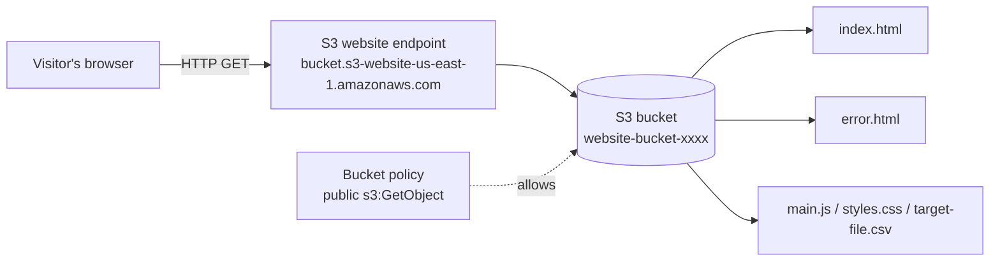

# Lab 01 – Static Website Hosting on Amazon S3

**Source:** AWS SimuLearn – *Cloud Computing Essentials* (Practice section)
**Date:** 2026-11-01
**Region:** us-east-1 (N. Virginia)

## Goal

Host a static website (the "Beach Wave Conditions" page) directly from an Amazon S3 bucket —
no servers to run, patch or scale.

## Architecture



## Key concepts

| Concept | What it means |
|---------|---------------|
| **S3 bucket** | A container for objects (files). Bucket names are globally unique. |
| **Object** | A file plus its metadata, addressed by a key (e.g. `index.html`). |
| **Static website hosting** | S3 serves objects over HTTP as a website, with an index document and an error document. |
| **Block Public Access** | Account/bucket-level guardrail that overrides any public permission. Must be **off** for a public website. |
| **Bucket policy** | A resource-based JSON policy attached to the bucket that defines who can do what. |
| **Website endpoint** | `http://<bucket>.s3-website-<region>.amazonaws.com` — HTTP only (use CloudFront for HTTPS). |

## Steps performed

1. Opened the **S3** console and selected the pre-created bucket `website-bucket-xxxx`.
2. Reviewed the 5 objects: `index.html`, `main.js`, `styles.css`, `target-file.csv`, `text.html`.
3. Renamed `text.html` → **`error.html`** (*Actions → Rename object*). This becomes the page shown when a request fails (e.g. 404).
4. **Permissions tab**
   - Confirmed **Block all public access = Off** (required for public web hosting).
   - Reviewed the bucket policy ([`bucket-policy.json`](bucket-policy.json)) granting public read-only access.
5. **Properties tab**
   - Reviewed **Default encryption** (SSE-S3, objects encrypted at rest).
   - **Static website hosting → Edit**:
     - Static website hosting: **Enable**
     - Hosting type: **Host a static website**
     - Index document: **`index.html`**
     - Error document: **`error.html`**
   - Saved changes.
6. Copied the **Bucket website endpoint** and opened it in a browser to load the site.

## Bucket policy explained

```json
{
  "Version": "2012-10-17",
  "Id": "StaticWebPolicy",
  "Statement": [
    {
      "Sid": "S3GetObjectAllow",
      "Effect": "Allow",
      "Principal": "*",
      "Action": "s3:GetObject",
      "Resource": "arn:aws:s3:::website-bucket-xxxx/*"
    }
  ]
}
```

- `Principal: "*"` → anyone on the internet
- `Action: s3:GetObject` → **read only** — visitors can download files but cannot upload, delete or list
- `Resource: .../*` → applies to every object *inside* the bucket (not the bucket itself)

This follows **least privilege**: grant only the single action a website visitor needs.

## Lessons learned

- Two locks must both be opened for a public site: **Block Public Access off** *and* a **policy that allows reads**.
- The S3 website endpoint is **HTTP only**. Chrome may show a "connection is not secure" warning. Production sites put **CloudFront** in front for HTTPS, caching and a custom domain (Route 53).
- Renaming in S3 is really *copy + delete* — S3 has no true rename.
- The error document gives users a friendly page instead of a raw S3 XML error.

## Exam tips (SAA-C03)

- "Cheapest / simplest way to host a static site" → **S3 static website hosting** (+ CloudFront for HTTPS/global).
- Website endpoint format: `bucket-name.s3-website-region.amazonaws.com` (dash or dot before region depending on region).
- To keep the bucket **private** while serving through CloudFront → use **Origin Access Control (OAC)** instead of a public policy.
- Bucket name must match the domain name when pointing a Route 53 alias directly at an S3 website.

## Cleanup

Lab ran in a temporary SimuLearn account — ended via **End Lab**, so all resources were removed automatically.
In a personal account: disable website hosting, empty the bucket, then delete it.
